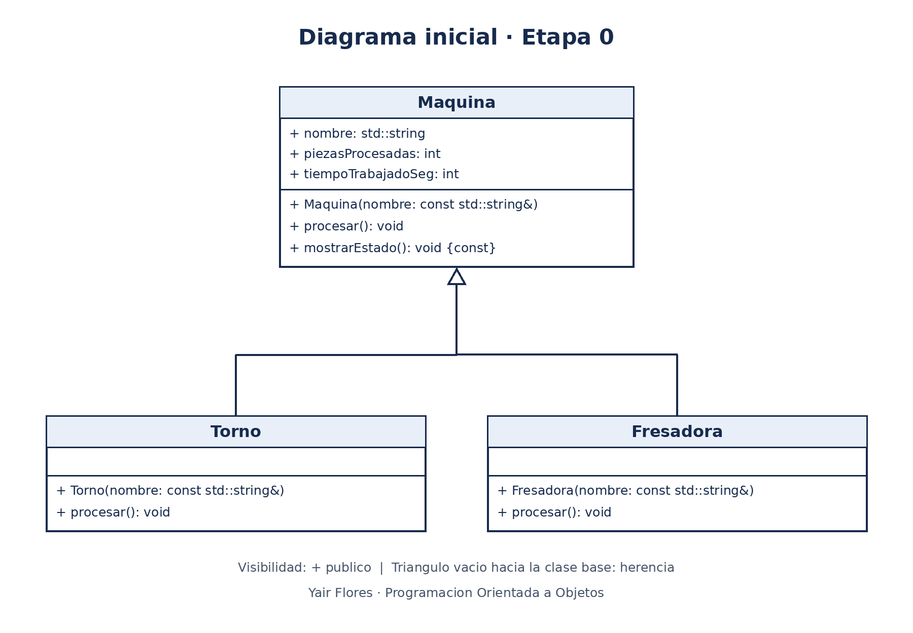

# Práctica Unidad IV: La evolución de una máquina

Programación Orientada a Objetos · Ingeniería Mecatrónica · Tercer semestre

Llena cada espacio conforme avances en las fases de [PRACTICA.md](PRACTICA.md).

## Fase 1. Entender el problema

**1.1 El problema con mis propias palabras**

Una planta necesita controlar varias máquinas que procesan piezas, como tornos y fresadoras. El programa debe llevar el registro de cuántas piezas procesa cada máquina, cuánto tiempo trabaja y cuál es su capacidad por hora. Durante la práctica vamos a mejorar el diseño para evitar datos incorrectos y permitir que otros equipos agreguen máquinas nuevas.

**1.2 Reglas que siempre deben cumplirse en una máquina**

1. El nombre de la máquina no debe estar vacío.
2. La cantidad de piezas procesadas y el tiempo trabajado nunca deben ser negativos.
3. El tiempo que dura un ciclo siempre debe ser mayor que cero.
4. Cada ciclo completado debe registrar una pieza y sumar el tiempo correspondiente.

**1.3 ¿Quién más usa la clase `Maquina`? ¿Qué podría salir mal si otro equipo crea una máquina nueva sin conocer tus reglas?**

La utilizan los equipos que desarrollan máquinas nuevas y el programa que controla la línea de producción. Si un equipo no conoce las reglas, podría crear una máquina que no registre sus piezas, acumule tiempos incorrectos o tenga un tiempo de ciclo igual a cero. Esto provocaría reportes incorrectos de la producción.

## Fase 2. Diseñar la solución

**2.1 Diagrama inicial (Etapa 0)**

**2.2 Diagrama final (Etapa 9)**

**2.3 ¿Qué cambió entre los dos diagramas?**

| Elemento | Etapa 0 | Etapa 9 | Etapa que lo cambió |
| --- | --- | --- | --- |
| Visibilidad de los atributos de `Maquina` | _____ | _____ | _____ |
| `procesar()` | _____ | _____ | _____ |
| `tiempoCicloSeg()` | _____ | _____ | _____ |
| Destructor de `Maquina` | _____ | _____ | _____ |
| ¿Se pueden crear objetos `Maquina`? | _____ | _____ | _____ |
| Relación `ControlDeLinea` - `Maquina` | _____ | _____ | _____ |
| Relación `Torno` - `Motor` | _____ | _____ | _____ |
| Relación `BandaTransportadora` - `Motor` | _____ | _____ | _____ |

## Fase 3. Implementar

**3.0 Etapa 0. Una máquina sin reglas**

a) ¿Qué imprime `ejecutarTurno()` para el torno y la fresadora? ¿Por qué no imprime "torneando" ni "fresando"?

Imprime "procesamiento generico" para ambas máquinas. La función recibe una referencia de tipo Maquina y procesar() no es virtual. Por eso se utiliza el método de Maquina según el tipo declarado de la referencia. Esto se llama enlace estático.

b) ¿Por qué el torno acumula 65 s y no 135 s?

La llamada directa ejecuta el método del torno y suma 45 segundos. Los dos ciclos dentro de ejecutarTurno() ejecutan el método de Maquina, que suma 10 segundos por ciclo. Por eso acumula 45 + 10 + 10 = 65 segundos.
**3.1 Etapa 1. Invariantes y constructores explicit**

a) ¿Qué regla de la sección 1.2 rompió `torno.piezasProcesadas = -5;`?

Rompió la regla de que la cantidad de piezas procesadas nunca debe ser negativa. Como el atributo era público, se podía modificar directamente sin ninguna validación.

b) ¿De dónde salió la máquina "Fantasma"? ¿Qué hizo el compilador sin que se lo pidieras?

El compilador convirtió automáticamente el objeto std::string llamado codigo en una Maquina temporal, utilizando el constructor de un solo parámetro. Al agregar explicit al constructor, esa conversión implícita deja de estar permitida.

c) ¿Qué tuviste que cambiar en `Torno` y `Fresadora` y por qué?

Tuve que reemplazar el acceso directo a los atributos por getNombre(), registrarPieza() y agregarTiempo(), porque los atributos de Maquina ahora son privados. También declaré sus constructores como explicit. Así las derivadas utilizan los métodos de la base para consultar y actualizar los datos respetando las reglas.

**3.2 Etapa 2. Virtual y override**

a) La fresadora acumula 180 s, pero reporta 360 pzas/h. ¿Por qué un cálculo usó 60 s y el otro 10 s?

[Inserta aquí tu respuesta]

b) ¿Tu compilador mostró alguna advertencia antes de usar `override`? ¿Qué mensaje dio después de agregar `override`?

[Inserta aquí tu respuesta]

**3.3 Etapa 3. La línea de producción**

a) ¿Por qué la línea procesó todo como "generico" si `procesar()` ya es virtual?

[Inserta aquí tu respuesta]

b) ¿Por qué el torno y la fresadora originales quedaron con 0 piezas?

[Inserta aquí tu respuesta]

c) La relación entre `ControlDeLinea` y `Maquina`, ¿es composición o agregación? ¿Por qué?

[Inserta aquí tu respuesta]

**3.4 Etapa 4. Destructores**

| Momento | Mensajes de destrucción que aparecieron |
| --- | --- |
| `delete temporal;` sin destructor virtual | _____ |
| `delete temporal;` con destructor virtual | _____ |
| Al terminar `main` (torno y fresadora) | _____ |

a) ¿Qué advertencia mostró el compilador? ¿Por qué decimos que ya te estaba avisando del problema?

[Inserta aquí tu respuesta]

b) ¿Por qué el torno de `main` sí se destruyó completo aunque el destructor no fuera virtual? ¿A qué máquina corresponde el primer "Destruyendo Maquina" después de "Fin de main"?

[Inserta aquí tu respuesta]

**3.5 Etapa 5. La clase abstracta**

a) Copia los mensajes de error y explica con tus palabras qué dice cada uno.

[Inserta aquí tu respuesta]

b) ¿Por qué es mejor este error de compilación que el comportamiento "generico" de antes?

[Inserta aquí tu respuesta]

**3.6 Etapa 6. El contrato que el compilador no ve**

a) ¿Qué partes del contrato violó `InspeccionVisual`?

[Inserta aquí tu respuesta]

b) ¿Por qué el compilador no lo detectó?

[Inserta aquí tu respuesta]

c) ¿Qué pasaría si el próximo equipo tampoco lee el comentario del contrato?

[Inserta aquí tu respuesta]

**3.7 Etapa 7. La base hace cumplir el contrato**

a) ¿Cómo puede una clase derivada sobrescribir un método que es privado en la base?

[Inserta aquí tu respuesta]

b) ¿Qué ocurre ahora con una máquina cuyo tiempo de ciclo es 0? Compáralo con la Etapa 6.

[Inserta aquí tu respuesta]

c) ¿Por qué la línea ignoró el "atajo" del torno, pero la llamada directa no? ¿Cómo corregiste el diseño?

[Inserta aquí tu respuesta]

**3.8 Etapa 8. Herencia mal usada**

a) Da al menos dos razones por las que `BandaTransportadora : public Motor` es un error de diseño.

[Inserta aquí tu respuesta]

b) La relación entre `BandaTransportadora` y `Motor`, ¿es composición o agregación? ¿Por qué?

[Inserta aquí tu respuesta]

**3.9 Etapa 9. La librería y la prueba final**

a) Después de agregar la `Cortadora`, ¿qué archivos mostró `git status`? ¿Cuántos archivos de la librería tuviste que modificar?

[Inserta aquí tu respuesta]

b) ¿Qué pasó al escribir `-lplanta` antes de `src/main.cpp`? ¿Por qué?

[Inserta aquí tu respuesta]

**3.10 Bitácora de dudas**

| # | Etapa | Duda | Cómo la resolví | Fuente |
| --- | --- | --- | --- | --- |
| 1 | _____ | _____ | _____ | _____ |
| 2 | _____ | _____ | _____ | _____ |
| 3 | _____ | _____ | _____ | _____ |

## Fase 4. Probar y mejorar

**4.1 Tabla de pruebas**

| # | Caso | Resultado esperado | Resultado obtenido | ¿Pasa? |
| --- | --- | --- | --- | --- |
| 1 | Máquina con nombre vacío | Excepción con mensaje claro | _____ | _____ |
| 2 | Reporte de una línea vacía | "La linea no tiene maquinas" | _____ | _____ |
| 3 | `agregar(nullptr)` | Devuelve `false` | _____ | _____ |
| 4 | Reporte antes de ejecutar el turno | 0 piezas, 0 s y capacidad calculada | _____ | _____ |
| 5 | Turno de 0 ciclos | Nada cambia | _____ | _____ |
| 6 | Torno con 3 ciclos | 3 piezas, 135 s, 80 pzas/h | _____ | _____ |
| 7 | Máquina con `tiempoCicloSeg()` igual a 0 | Excepción con mensaje claro | _____ | _____ |
| 8 | Máquina con `tiempoCicloSeg()` negativo | Excepción con mensaje claro | _____ | _____ |
| 9 | La misma máquina agregada dos veces | _____ | _____ | _____ |

**4.2 Bitácora de mejoras**

| # | Falla o mejora detectada | Qué cambié | Por qué |
| --- | --- | --- | --- |
| 1 | _____ | _____ | _____ |
| 2 | _____ | _____ | _____ |

Retos opcionales que intenté: _____

## Fase 5. Publicar en GitHub

**5.1 Enlace a mi fork**

[Inserta aquí el enlace a tu fork]

## Cierre y reflexión

**6.1 Errores que ya no pueden ocurrir**

| Error | Etapa en que apareció | Restricción que lo impide ahora | ¿Quién lo detecta: el compilador o el programa? |
| --- | --- | --- | --- |
| Contadores con valores inválidos | _____ | _____ | _____ |
| Máquina "fantasma" creada a escondidas | _____ | _____ | _____ |
| Método que no sobrescribe por un `const` | _____ | _____ | _____ |
| Máquinas copiadas y "rebanadas" | _____ | _____ | _____ |
| Destrucción incompleta | _____ | _____ | _____ |
| Máquina sin `procesar()` propio | _____ | _____ | _____ |
| Tiempo de ciclo inválido | _____ | _____ | _____ |
| Derivada que no registra sus piezas | _____ | _____ | _____ |

**6.2 ¿Cuál de los errores fue el más peligroso: el de compilación, la advertencia o el que compilaba sin problemas? ¿Por qué?**

[Inserta aquí tu respuesta]

**6.3 ¿Qué aprendiste en esta práctica?**

[Inserta aquí tu respuesta]

**6.4 ¿Qué cambiarías de tu proceso la próxima vez?**

[Inserta aquí tu respuesta]
