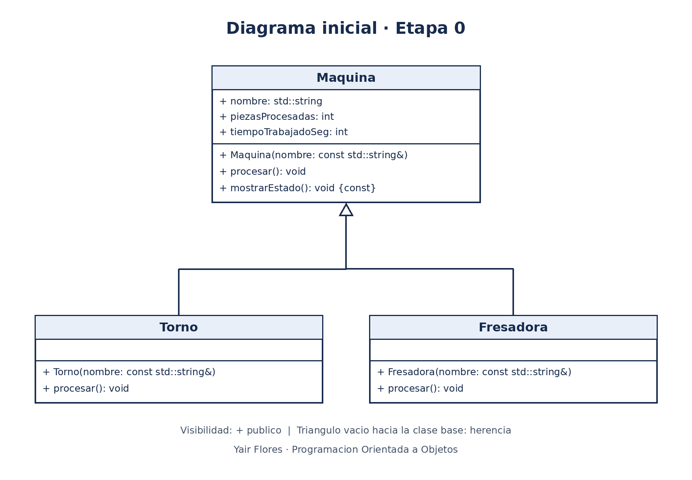
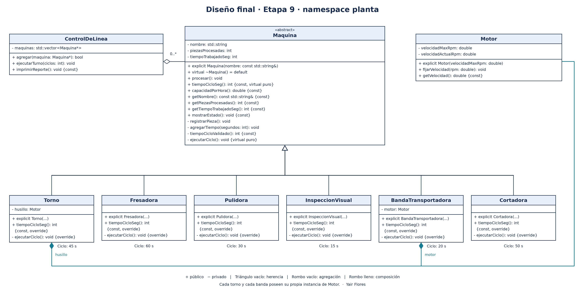

# Práctica Unidad IV: La evolución de una máquina

Programación Orientada a Objetos · Ingeniería Mecatrónica · Tercer semestre

Llena cada espacio conforme avances en las fases de [PRACTICA.md](PRACTICA.md).

## Fase 1. Entender el problema

**1.1 El problema con mis propias palabras**

Una planta necesita controlar varias máquinas que procesan piezas, como tornos y fresadoras. El programa debe llevar el registro de cuántas piezas procesa cada máquina, cuánto tiempo trabaja y cuál es su capacidad por hora. Durante la práctica vamos a mejorar el diseño para evitar datos incorrectos y permitir que otros equipos agreguen máquinas nuevas.

**1.2 Reglas que siempre deben cumplirse en una máquina**

1. El nombre de la máquina no debe estar vacío.
2. La cantidad de piezas procesadas y el tiempo trabajado nunca deben ser negativos.
3. El tiempo que dura un ciclo siempre debe ser mayor que cero.
4. Cada ciclo completado debe registrar una pieza y sumar el tiempo correspondiente.

**1.3 ¿Quién más usa la clase `Maquina`? ¿Qué podría salir mal si otro equipo crea una máquina nueva sin conocer tus reglas?**

La utilizan los equipos que desarrollan máquinas nuevas y el programa que controla la línea de producción. Si un equipo no conoce las reglas, podría crear una máquina que no registre sus piezas, acumule tiempos incorrectos o tenga un tiempo de ciclo igual a cero. Esto provocaría reportes incorrectos de la producción.

## Fase 2. Diseñar la solución

**2.1 Diagrama inicial (Etapa 0)**

**2.2 Diagrama final (Etapa 9)**

**2.3 ¿Qué cambió entre los dos diagramas?**

| Elemento | Etapa 0 | Etapa 9 | Etapa que lo cambió |
| --- | --- | --- | --- |
| Visibilidad de los atributos de `Maquina` | Públicos | Privados | 1 |
| `procesar()` | Público, no virtual y con procesamiento genérico | Público, no virtual y controla las reglas del ciclo mediante `ejecutarCiclo()` | 2, 5 y 7 |
| `tiempoCicloSeg()` | No existía | Público, const y virtual puro | 2 y 5 |
| Destructor de `Maquina` | Implícito, no virtual | `virtual ~Maquina() = default;` | 4 |
| ¿Se pueden crear objetos `Maquina`? | Sí | No, es abstracta | 5 |
| Relación `ControlDeLinea` - `Maquina` | No existía | Agregación mediante punteros | 3 |
| Relación `Torno` - `Motor` | No existía | Composición mediante el husillo | 4 |
| Relación `BandaTransportadora` - `Motor` | No existía | Composición mediante un motor privado | 8 |

## Fase 3. Implementar

**3.0 Etapa 0. Una máquina sin reglas**

a) ¿Qué imprime `ejecutarTurno()` para el torno y la fresadora? ¿Por qué no imprime "torneando" ni "fresando"?

Imprime "procesamiento generico" para ambas máquinas. La función recibe una referencia de tipo Maquina y procesar() no es virtual. Por eso se utiliza el método de Maquina según el tipo declarado de la referencia. Esto se llama enlace estático.

b) ¿Por qué el torno acumula 65 s y no 135 s?

La llamada directa ejecuta el método del torno y suma 45 segundos. Los dos ciclos dentro de ejecutarTurno() ejecutan el método de Maquina, que suma 10 segundos por ciclo. Por eso acumula 45 + 10 + 10 = 65 segundos.
**3.1 Etapa 1. Invariantes y constructores explicit**

a) ¿Qué regla de la sección 1.2 rompió `torno.piezasProcesadas = -5;`?

Rompió la regla de que la cantidad de piezas procesadas nunca debe ser negativa. Como el atributo era público, se podía modificar directamente sin ninguna validación.

b) ¿De dónde salió la máquina "Fantasma"? ¿Qué hizo el compilador sin que se lo pidieras?

El compilador convirtió automáticamente el objeto std::string llamado codigo en una Maquina temporal, utilizando el constructor de un solo parámetro. Al agregar explicit al constructor, esa conversión implícita deja de estar permitida.

c) ¿Qué tuviste que cambiar en `Torno` y `Fresadora` y por qué?

Tuve que reemplazar el acceso directo a los atributos por getNombre(), registrarPieza() y agregarTiempo(), porque los atributos de Maquina ahora son privados. También declaré sus constructores como explicit. Así las derivadas utilizan los métodos de la base para consultar y actualizar los datos respetando las reglas.

**3.2 Etapa 2. Métodos virtuales y override**

a) ¿Por qué la fresadora acumula 180 s, pero reporta 360 pzas/h en el experimento?

Al procesar, la fresadora usa su propia función `tiempoCicloSeg()`, que devuelve 60 segundos. Por eso, al procesar tres piezas acumula 180 segundos. Pero como esa función no tenía `const`, su firma era distinta a la de `Maquina::tiempoCicloSeg() const`. Al calcular la capacidad se usaba la versión de `Maquina`, que devuelve 10 segundos, y el resultado era `3600 / 10 = 360 pzas/h`.

b) ¿Qué advertencia apareció antes de usar `override` y qué pasó al agregarlo?

Compilé directamente la versión corregida, así que no registré si apareció alguna advertencia en la versión inicial. Si se agrega `override` a la función de Fresadora sin el `const`, el compilador marca `marked 'override', but does not override` porque la firma no coincide con la de la clase base.

Al usar `const` en la declaración y en la implementación de `Fresadora::tiempoCicloSeg()`, la función sí sobrescribe la de `Maquina`. En la ejecución final, el torno dio 3 piezas, 135 s y 80 pzas/h. La fresadora dio 3 piezas, 180 s y 60 pzas/h.

**3.3 Etapa 3. La línea de producción**

a) En la versión que guarda objetos por valor, `std::vector<Maquina>` copia solo la parte de `Maquina`. Esto se llama slicing. Como las copias son objetos `Maquina`, su método virtual ejecuta el procesamiento genérico.

b) Los originales quedan con cero piezas porque el turno modifica las copias del vector. Al guardar punteros, el turno trabaja con los objetos originales.

c) Es agregación porque `ControlDeLinea` guarda las direcciones de máquinas que existen por su cuenta. La línea no las crea ni las destruye.

***3.4 Etapa 4. Destructores**

Resultados esperados del experimento de la guía:

| Momento | Mensajes esperados |
| --- | --- |
| `delete temporal` sin destructor virtual | La guía muestra solo `Destruyendo Maquina`. Es comportamiento indefinido, así que la salida no está garantizada. |
| `delete temporal` con destructor virtual | `Destruyendo Torno`, `Destruyendo Motor`, `Destruyendo Maquina`. |
| Al terminar `main` | Primero `Destruyendo Maquina` por la fresadora. Luego `Destruyendo Torno`, `Destruyendo Motor` y `Destruyendo Maquina` por el torno. |

a) La advertencia esperada es `-Wdelete-non-virtual-dtor`. Avisa que borrar un objeto derivado con un puntero a la base puede causar comportamiento indefinido si el destructor de la base no es virtual.

b) El torno local se destruye completo porque fue declarado como `Torno`. Los objetos locales se destruyen en orden inverso a su creación, por eso el primer `Destruyendo Maquina` corresponde a la fresadora.

**3.5 Etapa 5. La clase abstracta**

a) Los mensajes esperados del experimento son:

- `cannot declare variable 'pulidora' to be of abstract type 'Pulidora'`. A la primera versión de `Pulidora` le faltaba implementar `procesar()`.
- `cannot declare variable 'generica' to be of abstract type 'Maquina'`. `Maquina` es abstracta porque declara `procesar()` y `tiempoCicloSeg()` como métodos virtuales puros.

b) El error de compilación detecta una máquina incompleta antes de ejecutar el programa. Así la línea no puede reportar producción de una máquina genérica ni aceptar una pulidora que no define cómo procesar una pieza.

**3.6 Etapa 6. El contrato que el compilador no ve**

a) ¿Qué partes del contrato violó `InspeccionVisual`?

En el código incorrecto de la guía, no registraba la pieza ni sumaba el tiempo trabajado. Además, devolvía cero como tiempo de ciclo, aunque el contrato exige un valor mayor que cero. La versión corregida registra cada pieza y utiliza un ciclo de 15 segundos.

b) ¿Por qué el compilador no lo detectó?

Porque los métodos tenían los nombres, parámetros y tipos correctos. El compilador verifica esas declaraciones, pero no interpreta los comentarios ni comprueba que cada método cumpla las reglas de producción.

c) ¿Qué pasaría si el próximo equipo tampoco lee el comentario del contrato?

Podría repetir el problema y producir reportes incorrectos. Por eso conviene que la clase base controle el registro de piezas, el tiempo y sus validaciones, como se hará en la siguiente etapa.

**3.7 Etapa 7. La base hace cumplir el contrato**

a) ¿Cómo puede una clase derivada sobrescribir un método privado de la base?

El acceso y la sobrescritura son independientes. `private` controla quién puede llamar al método y `virtual` permite que una derivada implemente su propia versión. La base puede llamar a `ejecutarCiclo()` y ejecutar la versión de la máquina correspondiente.

b) ¿Qué ocurre ahora con un tiempo de ciclo igual a cero?

La base lanza `std::logic_error` antes de ejecutar el ciclo y registrar la pieza. En la Etapa 6, el código incorrecto podía calcular una capacidad infinita. Ahora la validación detecta el tiempo inválido y señala qué máquina falló.

c) ¿Por qué la línea ignora el atajo del torno y cómo se corrige?

La línea utiliza punteros `Maquina*`. Como `procesar()` no es virtual, llama al método de la base, que aplica las reglas. Un `procesar()` propio de Torno ocultaría ese método en las llamadas directas y podría saltarse el registro. La corrección consiste en eliminar el atajo y personalizar únicamente `ejecutarCiclo()`.

**3.8 Etapa 8. Herencia mal usada**

a) Da al menos dos razones por las que `BandaTransportadora : public Motor` es un error de diseño.

Una banda tiene un motor, pero no es un motor. Al heredar únicamente de Motor, no puede agregarse a ControlDeLinea porque la línea recibe punteros Maquina*. Además, expone fijarVelocidad() al resto del programa y permite cambiar directamente la velocidad del motor desde fuera de la banda.

La solución es heredar de Maquina y guardar un Motor como atributo privado. Así la banda participa en la línea y controla internamente su motor.

b) ¿La relación entre BandaTransportadora y Motor es composición o agregación?

Es composición porque el motor forma parte de la banda como atributo por valor. Se construye junto con ella y se destruye automáticamente cuando se destruye la banda.

**3.9 Etapa 9. La librería y la prueba final**

a) Después de agregar la Cortadora, ¿qué archivos mostró `git status`? ¿Cuántos archivos de la librería tuviste que modificar?

Los cambios de código fueron `src/main.cpp`, `Include/Cortadora.h` y `src/Cortadora.cpp`. No tuve que modificar ningún archivo de las clases existentes ni recompilar la librería para integrar la cortadora. La compilé por separado y la enlacé con `libplanta.a`.

b) ¿Qué pasó al escribir `-lplanta` antes de `src/main.cpp`? ¿Por qué?

Aparecieron errores `undefined reference`. El enlazador procesa los argumentos en orden y utiliza la librería estática para resolver las referencias que ya tiene pendientes. Por eso la librería debe ir después del código que la utiliza.

**3.10 Bitácora de dudas**

| # | Etapa | Duda | Cómo la resolví | Fuente |
| --- | --- | --- | --- | --- |
| 1 | 1 | ¿Por qué aparecía undefined reference a los métodos de Maquina? | Revisé que las funciones declaradas en el encabezado tuvieran su implementación en Maquina.cpp y guardé el archivo. | Mensajes de g++ y apoyo de ChatGPT |
| 2 | 2 | ¿Por qué aparecían funciones duplicadas y faltaba main? | Corregí main.cpp, donde se había pegado código de Maquina.cpp. | Mensajes del enlazador y apoyo de ChatGPT |
| 3 | 3 y 4 | ¿Por qué no encontraba ControlDeLinea.h y Motor.h? | Revisé las rutas con PowerShell y moví los archivos de Include/include a Include. | PowerShell, mensajes de g++ y apoyo de ChatGPT |
| 4 | 7 | ¿Cómo se puede sobrescribir un método privado? | Revisé que private controla el acceso y virtual permite ejecutar la implementación de la derivada. | PRACTICA.md y apoyo de ChatGPT |

## Fase 4. Probar y mejorar

**4.1 Tabla de pruebas**

Las nueve pruebas se ejecutaron mediante un programa temporal. El resultado fue 9/9 aprobadas.

| # | Caso | Resultado esperado | Resultado obtenido | ¿Pasa? |
| --- | --- | --- | --- | --- |
| 1 | Máquina con nombre vacío | Excepción con mensaje claro | Se lanzó invalid_argument con el mensaje "El nombre no puede estar vacio". | Sí |
| 2 | Reporte de una línea vacía | "La linea no tiene maquinas" | Se mostró el mensaje esperado. | Sí |
| 3 | `agregar(nullptr)` | Devuelve false | El puntero fue rechazado y devolvió false. | Sí |
| 4 | Reporte antes de ejecutar el turno | 0 piezas, 0 s y capacidad calculada | El torno reportó 0 piezas, 0 s y 80 pzas/h. | Sí |
| 5 | Turno de 0 ciclos | Nada cambia | El torno mantuvo 0 piezas y 0 s. | Sí |
| 6 | Torno con 3 ciclos | 3 piezas, 135 s y 80 pzas/h | Se obtuvieron los tres valores esperados. | Sí |
| 7 | Tiempo de ciclo igual a 0 | Excepción con mensaje claro | procesar() y capacidadPorHora() lanzaron logic_error. Los contadores permanecieron en cero. | Sí |
| 8 | Tiempo de ciclo negativo | Excepción con mensaje claro | Con -5 segundos, procesar() y capacidadPorHora() lanzaron logic_error. Los contadores permanecieron en cero. | Sí |
| 9 | La misma máquina agregada dos veces | Rechazar la segunda incorporación | La primera incorporación devolvió true y la segunda false. Un turno de un ciclo produjo una sola pieza y 45 s. | Sí |

**4.2 Bitácora de mejoras**

| # | Falla o mejora detectada | Qué cambié | Por qué |
| --- | --- | --- | --- |
| 1 | Una máquina podía incorporarse dos veces a la misma línea. | Agregué una búsqueda del puntero antes de insertarlo en ControlDeLinea. | Para evitar ciclos repetidos y un reporte que contabilice dos veces la misma máquina. |
| 2 | Las derivadas podían olvidar registrar las piezas o informar un tiempo inválido. | Centralicé la validación y el registro en Maquina::procesar(). | Para que todas las máquinas sigan las mismas reglas. |

Retos opcionales que intenté: rechazar una máquina que ya está registrada en la línea.

## Fase 5. Publicar en GitHub

**5.1 Enlace a mi fork**

https://github.com/yairflores09/ulsa_ime_3_poo_evolucion_maquina

## Cierre y reflexión

**6.1 Errores que ya no pueden ocurrir**

| Error | Etapa en que apareció | Restricción que lo impide ahora | ¿Quién lo detecta? |
| --- | --- | --- | --- |
| Contadores con valores inválidos por modificación directa | 1 | Atributos privados y actualización mediante métodos controlados | El compilador impide el acceso directo y el programa valida los tiempos |
| Máquina "fantasma" creada a escondidas | 1 | Constructor explicit | El compilador |
| Método que no sobrescribe por un const | 2 | override exige que la firma coincida | El compilador |
| Máquinas copiadas y "rebanadas" | 3 | La línea guarda Maquina* y Maquina es abstracta | El diseño evita las copias y el compilador impide crear objetos Maquina |
| Destrucción incompleta mediante un puntero a la base | 4 | Destructor virtual | El lenguaje garantiza la destrucción correspondiente al tipo real |
| Máquina sin comportamiento propio | 5 | Métodos virtuales puros. En el diseño final cada derivada implementa ejecutarCiclo() | El compilador |
| Tiempo de ciclo inválido | 6 | tiempoCicloValidado() comprueba que sea mayor que cero | El programa |
| Derivada que no registra sus piezas | 6 | La base registra las piezas al procesar mediante su interfaz | El diseño de Maquina::procesar() |

**6.2 ¿Cuál de los errores fue el más peligroso y por qué?**

El más peligroso fue el que compilaba sin problemas, porque parecía que todo estaba bien, pero el reporte podía tener datos incorrectos. Por ejemplo, una máquina podía ejecutar su trabajo sin registrar piezas o informar una capacidad incorrecta. Un error de compilación es más fácil de detectar porque detiene la construcción del programa.

**6.3 ¿Qué aprendiste en esta práctica?**

Aprendí a separar las declaraciones de las implementaciones, usar herencia y proteger los datos de una clase. Entendí que virtual permite ejecutar el comportamiento de la máquina correcta y que override ayuda a detectar diferencias en las firmas. También aprendí a distinguir composición y agregación, crear una clase abstracta y reutilizar las clases mediante una librería.

**6.4 ¿Qué cambiarías de tu proceso la próxima vez?**

Revisaría desde el principio los nombres y las ubicaciones de los archivos. También guardaría y compilaría después de cada cambio pequeño para detectar rápido los errores. Mantendría los commits por etapa y distinguiría los resultados observados de los resultados esperados de la guía.